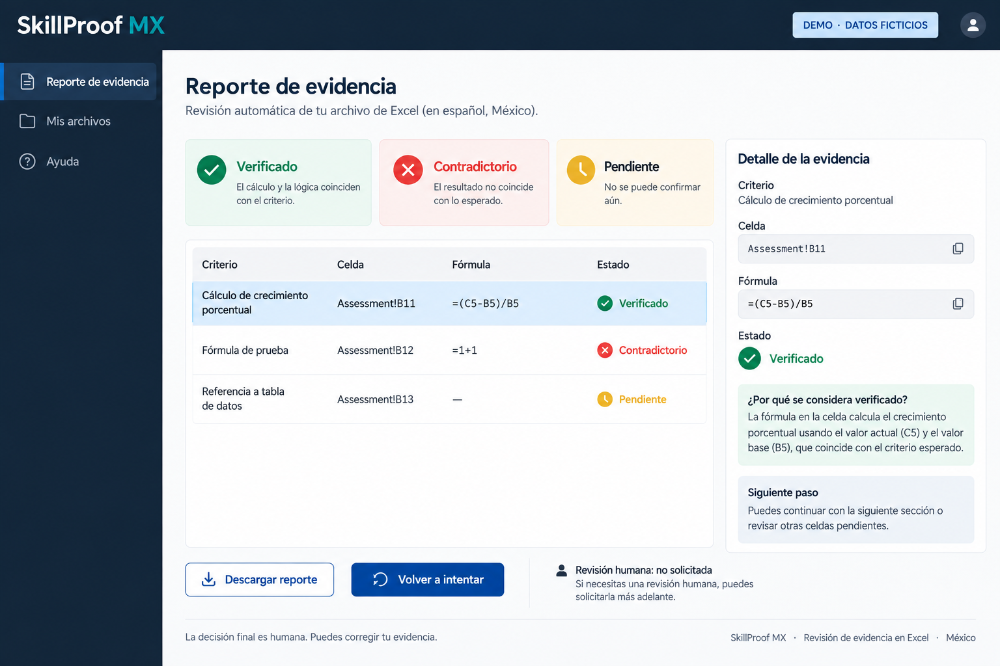
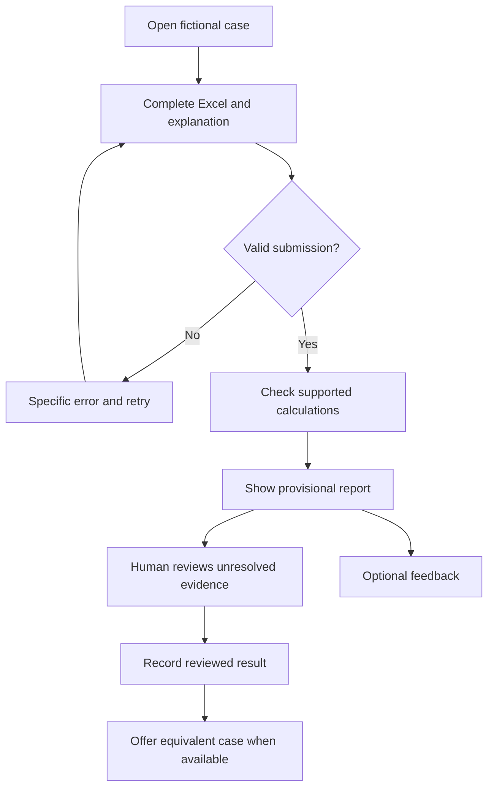
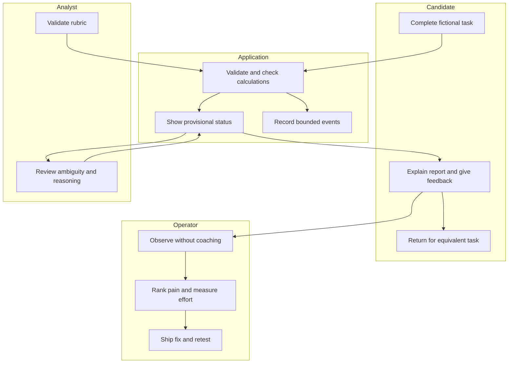

# SkillProof MX — Week 13 Packet

Valeria Karam Galland | Real Humans | 5 November 2026

Planning document prepared before Week 13 application changes. Baseline inspected: `week12-core`, tree `bd218f3b7b0eff9af0b6f0b6462c4c9e593d4c26`. Live URL: https://skillproof-mx.vercel.app/ . Repository: https://github.com/valeriakarambuilds-sketch/skillproof-mx . A custom owned domain is not confirmed. This document does not claim completed user sessions, fixes, deployments or review availability.

## 1. Problem in my words

Reviewing a junior financial analyst's Excel test requires checking calculations, formulas and reasoning. Automating calculations helps only if candidates understand the feedback and reviewers spend less time without overlooking valid alternative methods. A polished score can hide unresolved evidence; this week measures those failures with real users.

## 2. Exact user

Primary: Spanish-speaking students or recent graduates in Mexico interested in junior financial analyst roles, with basic Excel experience. Recruit five relevant participants, no classmates, including at least three strangers. Secondary: Valeria as pilot operator and a qualified analyst who validates the rubric and handles unresolved reasoning or formula questions. Analyst availability must be confirmed before collecting attempts that require promised review. Use fictional company data only.

## 3. Success before the module closes

Five real participants attempt the same defined workflow without coaching: download the case, complete it, submit evidence, read feedback and explain what remains provisional. Record role, task, struggles, exact quotes, assistance, completion and version. Rank the three worst findings, fix the highest-priority pain, redeploy and retest that task with before/after evidence. Obtain one authentic return signal. Complete a separate fresh-chat synthetic-persona pass and a documented mechanical bug-fix-redeploy cycle. Publish at least five substantive commits and two actual deployments; capture their IDs rather than treating this plan as evidence.

Exploratory gates: zero observed confirmed grading-rule errors left unresolved; at least four of five participants independently distinguish verified calculations from pending human review. Five sessions cannot establish broad assessment validity or a universal saving.

## 4. Image-generated mockup

Reuse the image-generated Week 12 evidence-report concept as the visual baseline; it is a design concept, not a screenshot or a new Week 13 generated asset.

Week 13 design delta: a prominent “Resultado provisional” notice; separate verified numerical checks and pending reasoning; specific next actions; a short optional feedback form. A return action may offer a reviewed equivalent case only when that case and reviewer are available. Do not imply that a button establishes a staffed appeal service.

## 5. Feature flow

## 6. Actor swimlane

## 7. Benchmark line

The best existing solution selected as my benchmark is TestGorilla's Microsoft Excel assessment, which evaluates spreadsheet skills and provides assessment reports; this selection is a design judgment, not a verified worldwide ranking. SkillProof MX differs through a narrow Spanish-language financial case with fictional MXN data, inspectable cell and formula evidence, explicit pending review and equivalent retries; Spanish alone is not a unique advantage because TestGorilla also has a Spanish offering.

Primary sources checked 5 November 2026:
- https://www.testgorilla.com/test-library/software-skills-tests/microsoft-excel-skills-test/
- https://www.testgorilla.com/es/catalogo-de-pruebas/conocimientos-de-software/prueba-de-microsoft-excel-general/

Do not claim the benchmark lacks these features without testing or documentation.

## 8. Long view — three sentences

In three years, SkillProof MX could provide a library of narrow financial work samples with validated rubrics for Mexican entry-level hiring. Candidates would receive understandable evidence and a path to demonstrate improvement through reviewed equivalent cases. Expansion would depend on measured grading quality, a sustainable review operation and employer demand, with consequential hiring decisions remaining human.

## 9. Scope cut and shadow condition

No automatic hiring decisions, job-readiness certification, broad formula execution, authorship certification, surveillance, payments or new marketplace. No claimed operating savings, willingness to pay or retention from hypothetical behavior. Unsupported formulas and reasoning remain pending human review; unresolved rubric questions never become candidate penalties. A confirmed faulty rule triggers an audit of affected attempts and private notification through an available authorized channel. Reduce the number of reviewed cases rather than broaden unjustified automatic grading. No real personal data in demos, seeds or public evidence.

## 10. Architecture and stack

| Layer | Existing stack / planned addition | Responsibility |
|---|---|---|
| Interface | Next.js 16, React 19, TypeScript, Tailwind | Spanish task, evidence report, feedback |
| API | Next.js routes, Zod | Validate inputs; compute bounded checks; retain provisional status |
| Excel parsing | fflate, fast-xml-parser | Inspect OOXML without executing arbitrary workbook code |
| Explanation | Existing Google GenAI integration and labeled simulated fallback | Advisory explanation only; never finalize reasoning without human review |
| Identity and reports | Existing Supabase Auth and Postgres/RLS integration | Private ownership; verify live configuration and isolation |
| Analytics | New small bounded event log | Task stages, errors, feedback, versions and return events |
| Review measurement | Private structured pilot log | Baseline and assisted hands-on effort, elapsed turnaround and corrections |
| Source and hosting | GitHub and Vercel free tiers | Reviewable history and real deployment evidence |

Inspection found the existing evaluation route adds explanation points into `total`; Week 13 must make provisional status explicit in API, UI, stored reports and exports. Existing code presence does not establish current live Auth/RLS correctness. Read installed Next.js guides before implementation as required by repository AGENTS.md.

## 11. Analytics and feedback contract

Proposed event names: `task_started`, `template_downloaded`, `submission_rejected`, `evaluation_completed`, `report_opened`, `feedback_submitted`, `equivalent_case_started`. Allowlist event names and bounded error codes; include timestamp, build identifier and case/rubric version. Use a consented pseudonymous participant code for pilot linkage; never put file names, workbook contents, explanation text, email addresses, tokens or raw errors in analytics. Separate technical logs from observed task success. Deduplicate return events; a reload is not proof of a meaningful repeat attempt.

Use an authenticated private store with ownership policies for persisted participant-linked records. Research notes and exact quotes remain private and require participant consent; publish only de-identified evidence. A free optional feedback form can capture a short confusion report, with length limits and an instruction not to enter personal information. No unrestricted public analytics dashboard.

## 12. Security floor

Keep secrets out of source and commit history; use deployment environment variables. Require Google sign-in before private persistence. Enable and verify RLS for every user-data table, including new analytics and feedback. Validate file size/type, archive contents, explanation length and all feedback/event fields on the server. Use visibly fictional seeds and screenshots. Check signed-out access and cross-account reads/writes; authorization must be enforced by the server/database, not by hiding UI controls. Record actual results before claiming the floor passes.

## 13. Mechanical test plan

| Test | Acceptance |
|---|---|
| Correct supported calculations | Expected values and traceable evidence; reasoning remains provisional |
| Valid unsupported formula | Pending review without a demonstrated-error penalty |
| Wrong supported calculation | Specific contradictory finding linked to cell and reference |
| AI unavailable or simulated | Visible label; no automatic final reasoning grade |
| Provisional report | UI, API, saved payload and export agree; no final pass/fail implication |
| Invalid/corrupt/oversize submission | Specific bounded error; no persisted workbook or raw error leak |
| Analytics | Allowlisted payloads, correct version, no prohibited content or duplicate return count |
| Feedback | Length/type validation and clear saved/failed state |
| Auth and isolation | Signed-out persistence blocked; B cannot read or modify A's data |
| Reload/export/retry | Current report preserved accurately; attempts not silently mixed |

Reproduce at least one actual failure, preserve pre-fix evidence, fix it, run the affected checks and redeploy. The provisional-total discrepancy is a code-inspection finding; reproduce the misleading behavior before reporting a tested fix.

## 14. Synthetic persona — Layer 1

Open a fresh chat: “You are Sofía, 23, a recent graduate in Mexico applying for junior financial analyst roles. You know basic Excel, worry that an automated score will permanently reject you and need to understand the next step. Use only the screenshots shown. Attempt the task aloud, state hesitation and where you would quit.” Show deployed screens in order. Preserve the confusion log; fix the worst issue and retest with screenshots from the corrected deployment. Synthetic findings remain separate from real participants.

## 15. Five-user protocol — Layer 2

Recruit relevant users as P01–P05, recording role and whether stranger or acquaintance without public names. Confirm at least three strangers and no classmates. Ask consent for observation and de-identified quotes; recording is optional and requires separate consent. Give the same neutral task: “Complete this fictional case, find your report and explain what the result does and does not establish.” Do not coach; record assistance when necessary. Ask what is verified, what needs review and what they would do next.

For every session record date, deployment/version, role, relationship category, task, completion, candidate time, assistance, exact quote, observation and evidence location. Leave unobserved fields unfilled; do not turn paraphrases into quotes. Offer an equivalent reviewed second case after feedback when review capacity is confirmed. Record actual return or a consented signup/message precisely; interest alone is not retention.

Rank the worst three findings first by grading harm, then task blockage/frequency, then candidate and operating effort. Each entry needs evidence, consequence for the value proposition, chosen action and retest result. Do not preselect a cosmetic issue as the highest pain before seeing the sessions.

## 16. Operating measurement and 10:1 case

Use the same case and rubric for manual and assisted review, with a qualified analyst reference. Record setup separately and allocate it over an explicit participant count. Include grading, reasoning review, unfamiliar formulas, support, corrections, appeals and second-review effort. Record hands-on time and elapsed turnaround separately; candidate effort is a separate measure. Counterbalance manual/assisted order where feasible and disclose learning effects.

Time ratio = manual operating minutes per completed assessment / assisted operating minutes per completed assessment. Report quality alongside time, sample size, setup allocation and unfinished work; never substitute server response time for the full operating denominator. Twenty minutes per attempt is a planning budget only. A second equivalent case shows observed post-feedback performance; it does not prove transfer to all financial tasks.

## 17. Implementation prompt and acceptance criteria

Starting from the inspected Week 12 branch, preserve the original Packet under `docs/week12/`, then place this Week 13 plan in `docs/PACKET.md` before application edits. Inspect existing code and installed framework documentation first. Implement small independent changes: explicit provisional report status; bounded analytics; private optional feedback; review-effort and session templates. Keep all numerical checks within analyst-validated rules and tolerance limits. Do not widen scoring, promise staffed review, create results or mark research complete.

Acceptance: all mechanical cases above pass; explanation cannot yield a final reviewed grade without recorded human review; analytics omit prohibited data; feedback and events enforce ownership; a reviewer can record actual effort privately; real-user and synthetic evidence are distinguishable. Test the full flow on the deployed version with fictional records.

Planned substantive commits:
1. Archive Week 12 Packet; commit Week 13 Packet and research protocol before code.
2. Reproduce provisional-total discrepancy; correct API/UI/export semantics with regression coverage.
3. Add validated private events and feedback with ownership checks.
4. Add pilot/review measurement support; complete mechanical checks; deploy baseline.
5. Fix the highest observed user pain; retest; deploy corrected version and preserve evidence.

If real sessions are not yet available, finish the technical baseline and stop short of claiming commit 5 or the milestone complete. Record any additional commits honestly. Each session ends with DECISIONS.md, the next first move, commit and push; deployment records must reference actual commits.

## 18. Evidence and hand-in ledger

| Deliverable | Evidence required / current state |
|---|---|
| Packet before code | This plan; repository commit pending |
| Live URL and owned domain | Supplied Vercel URL; owned domain unconfirmed |
| Five real sessions | Not supplied or conducted in this conversation |
| Top-three ranking and highest pain fix | Depends on sessions; no results claimed |
| Return signal | No evidence supplied |
| Persona PDF | Fresh-chat walkthrough and retest pending |
| BuildChat PDF | Preserve actual full development back-and-forth |
| Five commits / two deployments | Week 13 evidence pending |
| Demo video | 3-minute live walkthrough plus 30 seconds on an actual mind-change |

Source basis: supplied Week 13 Business Bending and Crystal Ball Brief; attached Team Blueprint; inspected repository files AGENTS.md, docs/PACKET.md, package.json and src/app/api/evaluate/route.ts on week12-core; official TestGorilla pages listed above. This is the pre-build plan, not a completion report.
