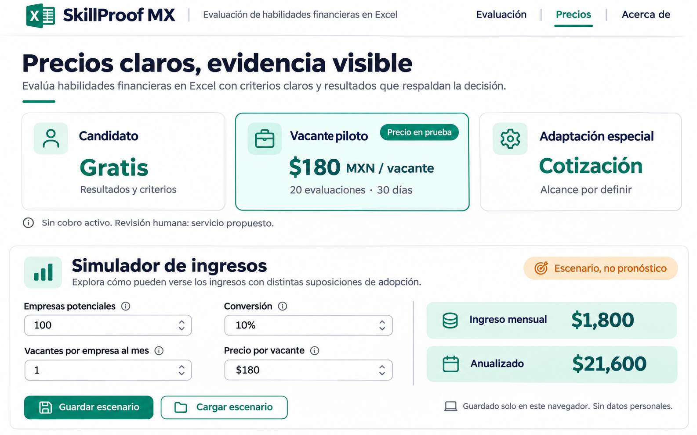
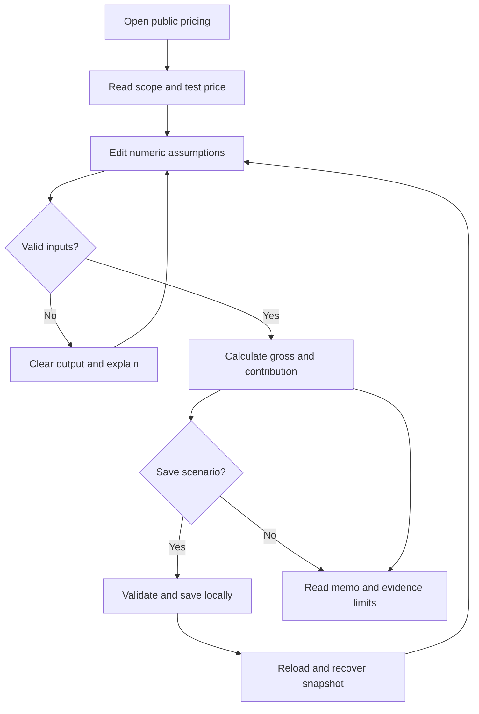
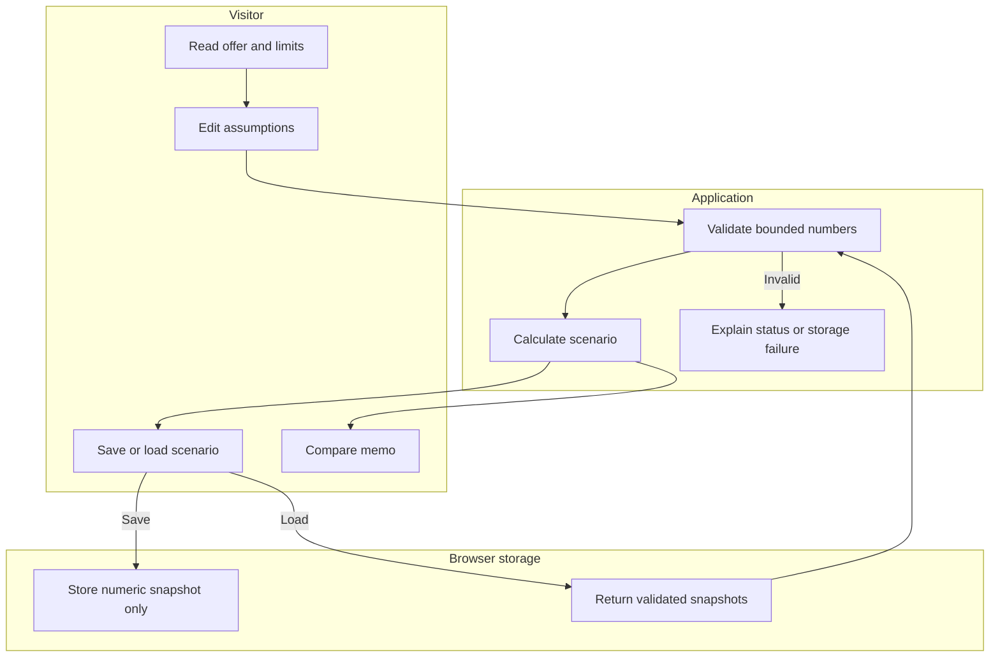
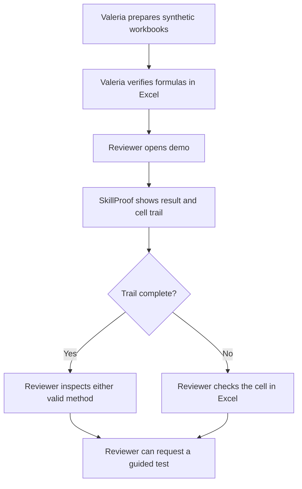

# SkillProof MX - Week 14 Packet: pricing and saved scenarios

Owner: Valeria Karam Galland. Lens: USER. Status: written before Week 14 implementation. Base: published Week 13 commit dc86a9c. Product URL of record: https://skillproof-mx.vercel.app. Repository: https://github.com/valeriakarambuilds-sketch/skillproof-mx, implementation branch week14-pricing.

## 1. Problem in my words
An occasional employer reviewing junior analysts' Excel work needs to compare different methods and inspect evidence. Candidates need free access to their own results and a way to question errors. We do not yet know whether SkillProof saves review time or whether the proposed service can be delivered profitably. This slice states the price hypothesis, exposes its assumptions and lets a visitor save and recover numeric revenue scenarios without creating a false promise of payment or staffed review.

## 2. Exact users and payer
- Candidate: recent graduate in Mexico applying for a junior financial analyst role; existing assessment remains free.
- Operational user: person checking Excel submissions, possibly distinct from the payer.
- Payer: employer budget holder. Segment A: small firms hiring occasionally. Segment B: employers with repeated junior-analyst vacancies; unvalidated secondary hypothesis.
- Price basis: one vacancy, not a candidate, seat or automatic monthly subscription. Existing employer access to candidate reports is not introduced by this slice.

## 3. Success before the module closes
A signed-out visitor can open /pricing and /about at the URL of record, distinguish the three options and two buyer segments, edit valid assumptions, see monthly and annualized gross plus contribution, save numeric scenarios on the current browser, reload and load/delete them. Invalid input clears output and prevents saving. The one-page memo uses the same baseline and price as pricing and the calculator. At least five meaningful commits and two READY deployments, including an observed fix and redeployment, are recorded. Independent human retest and genuine voluntary return remain separate evidence requirements, not synthetic-test claims.

## 4. Offer and current capability boundary
| Option | Price / unit | Proposed scope | Current boundary |
|---|---|---|---|
| Candidate | MXN 0 | Existing task and evidence report | Existing account rules apply to private reports; no candidate fee |
| Vacancy pilot | MXN 180 / vacancy | Up to 20 equivalent assessments, 30 days | Price test, not an active purchase or staffed employer service |
| Special adaptation | Quote after costing | Role-specific changes with defined scope | No fixed price, no active quote submission |

The two employer segments use the same per-vacancy test price until differentiated willingness to pay is evidenced. Do not quietly replace MXN 180 with Fernando's generic subscription prices. Basic results, criteria and the ability to question errors must not become paid candidate features. The existing review button gives instructions; no operational reviewer or response deadline is promised.

## 5. Evidence and arithmetic
Reported director conversation, paraphrased: files are reviewed manually; different methods are difficult to compare; he would try formula visibility and error review and would consider MXN 180 conditional on usefulness. Date, literal quotation, budget authority, actual payment and measured times have not been supplied. One reported conditional response is not a market estimate.

Illustrative same-task baseline: 20 candidates per vacancy; 10 manual hours vs 4 assisted hours including setup; MXN 300/hour; price MXN 180. Baseline = 3,000. Assisted labor = 1,200. Product total = 1,380. Net saving = 1,620. Gross time value/price = 1,800/180 = 10:1. Total-cost improvement = 3,000/1,380 = 2.17x. These ratios are different; none establishes measured ten-times-better performance. Do not monetize hiring quality, risk avoidance or more consistent review without evidence.

## 6. Simulator contract and defaults
Monthly eligible businesses x conversion/100 = expected paying businesses. Multiply by average vacancies per paying business per month, then price per vacancy, to obtain monthly gross. Annualized gross = monthly gross x 12, explicitly assuming an unchanged month; not a cohort forecast. Fractional expected buyers/units are allowed and explained.

| Default | Value | Status |
|---|---:|---|
| Eligible employers | 100 | Illustrative assumption |
| Conversion | 10% | Illustrative assumption, not observed conversion |
| Vacancies / paying employer / month | 1 | Illustrative editable frequency |
| Price / vacancy | MXN 180 | Unvalidated test offer |
| Processing / vacancy | MXN 5 | Illustrative cost, not a provider quotation |
| Infrastructure / vacancy | MXN 5 | Illustrative cost |
| Support and correction / vacancy | 30 minutes | Illustrative human effort |
| Human hourly cost | MXN 300 | Illustrative labor value |
| Customization / vacancy | MXN 0 | No special adaptation included |
| Fixed monthly overhead | MXN 0 | Not measured, editable; omitted overhead means no profit claim |

Variable unit cost = processing + infrastructure + human minutes/60 x hourly cost + included customization. Default unit cost = 160, contribution/unit = 20, monthly units = 10, monthly gross = 1,800, annualized gross = 21,600, contribution before fixed overhead = 200. Contribution is not net profit; tax treatment and real collection costs remain unverified. At zero gross, margin is undefined, not NaN. Invalid/blank/nonfinite/negative inputs yield no stale result; percentages limited to 0-100 and all fields bounded. Save at most ten validated numeric snapshots, automatic timestamps, no names, employer identifiers, free text or reports.

## 7. Image-generated mockup

Generation brief: Spanish SkillProof MX pricing page, white/navy/teal, Candidate Free; Vacancy pilot MXN 180, 20 assessments, 30 days; adaptation quoted. Editable users, conversion, frequency and price, gross 1,800 / annualized 21,600; scenario label, local save/load and no active billing. Generated before implementation. Cost assumptions will be added in the working version.

## 8. Feature flow

## 9. Actor swimlane

No AI or reviewer participates in numeric projections. A future correction service requires a separately defined human workflow and budget.

## 10. Benchmark line
Best existing reference for structured skills assessments: TestGorilla; its candidate guide documents assessment instructions, results and employer involvement. SkillProof localizes one inspectable Excel case in Spanish/MXN and tests employer payment per vacancy, with uncertainty and free correction access explicit; it does not claim incumbent absence from Mexico or a validated appeal-service advantage.
Source checked 12 November 2026: https://candidates.testgorilla.com/hc/en-us/articles/19092940874395-Comprehensive-guide-to-taking-your-assessment . This is a reference choice, not an independently proven world ranking. The current guide says employer sharing can affect results visibility.

## 11. Three-year long view
SkillProof could become a small library of employer-validated Excel assessments for entry-level roles in Mexico. Candidates would control their current evidence while reviewers retain accountable judgment and correction routes. Expansion would depend on measured validity, fairness, employer demand and operational review capacity rather than permanent candidate labels.

## 12. Scope cut
No checkout, payment collection, renewal, employer dashboard, real candidate comparison, new AI scoring, new Supabase table, staffed appeal service or automatic rejection. No personal data in scenario storage. Do not claim actual annual revenue, retention, measured savings or completed independent human retests. Preserve the existing two-part submission, Google account flow and private reports.

## 13. Architecture and stack
| Layer | Existing / selected technology | Responsibility |
|---|---|---|
| Public pages | Existing Next.js App Router, React, TypeScript | /pricing, /about, navigation |
| Calculator | Pure TypeScript + bounded validation | Deterministic arithmetic, no AI |
| Saved scenarios | Browser localStorage | Nonpersonal numeric snapshots, load/delete, failure feedback |
| Styling | Existing CSS with scoped pricing classes | Responsive, keyboard-friendly fields |
| Existing private reports | Supabase Google Auth + existing RLS | Preserve ownership; unchanged schema |
| Hosting / versioning | Existing Vercel project + GitHub | Same canonical domain, five commits/two deploys |
| Tests | Existing Vitest + Next build | Boundary, roundtrip, corruption and arithmetic tests |

## 14. Security floor
No new secrets; server secrets stay in deployment environment. Public calculator saves only numbers locally. Existing personal reports require verified server auth and owner-restricted RLS; read source and inspect deployed configuration where available, do not claim a live A/B retest without running it. Every new input has type/range limits; saved JSON is untrusted on load and validated. Labels and demo values are fictional. No auth state or personal report is exported into public evidence.

## 15. Two-pass test plan
Mechanical: known default outputs; zero users/conversion/price; 0 and 100% conversion; blank/negative/Infinity/excessive values; fractional expected volumes; negative contribution; save/reload/load/delete; invalid JSON, unsupported versions and storage failure; /pricing and /about anonymous GET; mobile overflow; existing tests/build; one real observed defect fixed and redeployed. Record exact commands, result, commit and deploy IDs.

Synthetic persona in a fresh chat: Lucia, 38, fictional operations manager at a small Mexican advisory firm, hires occasionally, basic Excel, wants to know whether 180 is monthly, whether review is staffed and where saved scenarios live. Walk actual screens in order, log hesitations, fix worst issue and retest. Synthetic persona results are never real payer evidence. If a fresh-chat screenshot walkthrough is not run, mark it pending rather than invent success.

## 16. Week 13 feedback carried forward
Professor score: public product 4/4; packet 2/2; Blueprint/validation 1/2; fix/redeploy 1/1; conversation 1/1 = 9/10. Participant accounts do not establish the full stranger/session record. An invited follow-up is not a voluntary return. Keep the existing P01-P05 ledger with missing fields explicitly pending. Independent retest: observe the two-item submission without coaching, record exact words, build, consent, assistance, task result and where the correction still fails. Record voluntary return separately only if genuinely initiated by the user. These are real-user tasks Valeria must carry out; developer checks do not close them.

## 17. Commit / deployment plan
1. docs: packet, mockup, diagrams, prompt and evidence boundaries BEFORE code.
2. feat: shared assumptions and deterministic scenario model.
3. feat: public pricing, memo and saved scenarios; deploy A.
4. fix: observed mechanical/persona defect with regression evidence; deploy B.
5. docs: exact test/deployment results and Session Close; commit and push.

Session Close updates DECISIONS.md with decisions, limits and tomorrow's first move. Future changes repeat this close.

# Week 15 — Distribution

**Builder:** Valeria Karam · **Lens:** Adversary · **Status:** Pre-build plan

## Problem, exact user and positioning

A finance reviewer at a small Mexican firm has already received Excel cases for a junior analyst vacancy. When three workbooks agree on EBITDA, the reviewer still has to open each one to learn how the answer was built. Start with a reviewer in that situation, such as someone at BIE reviewing an active analyst search. SkillProof MX shows the formula trail and where to inspect it in Excel. One Week 13 sample displayed formula evidence. The director's Week 14 feedback indicated conditional interest in seeing formulas and checking errors. The Week 15 Fusion surfaced the risk of being read as a candidate grading tool. **Promise withheld:** measured time savings. A later comparison must count upload and manual Excel review.

## Success and scope

- In a signed-out synthetic demo, hold EBITDA at MXN 1,600,000 across three workbooks: pasted value, direct formula and formula via an intermediate sheet. Display the sheet and cell trail for both valid methods and treat them equally. Flag incomplete traces for Excel review and preserve score and eligibility pending manual review.
- Publish three pieces across at least two formats after human approval. Put two pieces in front of the target audience in one channel and record observed behavior. Proposed learning signal: one reviewer can identify the incomplete trail and requests the next step for a live or recent analyst vacancy. Zero responses is a valid outcome.
- Keep the candidate journey and its access controls. This sprint excludes public upload of hiring workbooks, new candidate scoring, new hiring rules, a paid automation framework and pricing changes.

## Architecture and mockup

Reuse the existing Next.js / React app, server-side XLSX parsing and validation using fflate, fast-xml-parser and Zod. Proposed public route: read-only synthetic fixtures and no upload. Reuse a working secure capture option if available. Otherwise test an explicit opt-in reply through the same channel, with an evaluator-accessible demo link. Keep real files and contact details out of the public route and submission. Verify authentication and row-level access for any existing personal-data store used by the sprint. Keep secrets server-side and validate all inputs before processing.

**Image-generated mockup brief (pending generation):** Desktop reviewer view in Spanish. Three side-by-side workbook rows each show MXN 1,600,000. First row says “Revisar en Excel” with a cell location, second shows a direct formula, third expands an intermediate-sheet trail. Label “Ejemplo simulado.” End with “Solicitar una prueba guiada.” Use the palette below, no candidate names. Treat the generated image as a design reference and verify every displayed formula in the implementation separately.

**Benchmark and local adaptation:** Benchmark the demo against a reviewer using Excel's formula bar and precedent tracing on the same files. Keep the reviewer in Excel for final verification. Adapt the examples to Mexican Spanish, MXN and the point at which a small finance team already has submissions.

**Three-year direction:** Year 1 tests whether trace comparisons help small Mexican finance teams. Year 2 explores authenticated reviewer workspaces if pilots show repeat use. Year 3 explores other Excel-heavy analyst roles after checking equivalence and manual oversight for each rubric.

## Launch playbook

**Voice rules:** (1) Lead with the review task. (2) Point to a number, formula, worksheet or pending check. (3) Give the next action in plain Mexican Spanish.

**Rewrite:** “Contrata más rápido con IA” → “Tres archivos llegan al mismo EBITDA. Abre las celdas y compara cómo lo calculó cada uno.”

**Visual system:** Navy #14283F for titles, warm white #F7F8FA for backgrounds, teal #00695C for traceable paths and amber #8A5100 for review labels. Show text labels with every status. Use Inter bold for headlines, Inter regular for instructions and IBM Plex Mono for cells and formulas. Repeat the same order: reviewer question, workbook evidence, review action. Spanish labels, MXN and familiar Excel references make the content easy to use during a Mexican analyst search.

| Recurring series | First concept to finish | Second concept (sketch) |
| --- | --- | --- |
| Mismo resultado, distinto método | Three-workbook comparison as a carousel. Planned outreach piece A. | Which equivalent method would you open first when margins match? |
| Abre la celda | Short screen recording tracing an intermediate sheet. Planned outreach piece B. | How to locate the source cell when a formula crosses sheets. |
| Qué reviso antes de decidir | One-page checklist for a pasted value, incomplete trail and human follow-up. | What to do when a reviewer cannot reproduce a reference. |

**Input → method → output:** Start with the Week 13 displayed Excel evidence for EBITDA 2026 of MXN 1,600,000. Verify its source evidence before production. Recreate the amount in three labeled synthetic fixtures based on the established fictional financial case: 12,000,000 − 8,100,000 − 2,300,000. Compare a pasted result, direct subtraction and gross profit from an intermediate sheet less operating expenses. The useful output is a card and demo trail telling a reviewer exactly where to check each file. The three-file comparison is proposed for Week 15.

| Role | Input | Output | Quality check |
| --- | --- | --- | --- |
| Research | Blueprint, prior reviewer feedback and Week 13 evidence | Reviewer moment, claim list and source notes | Each claim tied to an observation or labeled hypothesis |
| Writing | Source notes and voice rules | Carousel copy, narration and checklist | Each piece contains a concrete review action |
| Visual production | Approved copy and synthetic workbook screenshots | Carousel, screen recording and checklist | Readable formulas and visible simulation label |
| Evidence checking | Drafts and three fixtures | Verified results and cell trails | Open the files in Excel, verify both formulas and check claims |
| Style review | Verified assets and palette | Marked edits | Consistent Spanish, labels and CTA across formats |
| Revision | Marked edits and test observations | Final versions | Valeria checks corrections and approves before publication |

## Tests and evidence

- **Mechanical:** Recalculate all three workbooks in Excel. Check equal treatment of both formula paths, the pasted-value review flag and score/eligibility behavior. Open the release and click the CTA signed out. Verify sample labels, lack of real data and that any saved personal information is access-controlled. Record expected and observed behavior and the tested URL and build.
- **Persona:** Use a fresh original chat with a synthetic finance reviewer grounded in the Blueprint and the director's feedback. Ask the reviewer to identify what differs, locate a precedent and interpret the pasted-value flag and CTA. Record exact observations. Separately rerun Ramsey's requested candidate regression with fresh state and a synthetic workbook: sign in, submit, inspect, retry and reopen the saved report. Fix and independently retest any reproduced issue. Keep persona evidence in PERSONA and distinguish it from outreach.
- **Distribution:** Proposed channel is individual email to finance reviewers who agree to receive the example. Send carousel and clip with the same working next action, a guided test request. Before sending, verify the demo and CTA and record the test window. Record pieces, delivered messages, observed clicks if measured, replies and opt-ins with aggregate counts only. Record expected behavior, observed behavior and the next change. As of this plan, outreach is pending and results are unmeasured.
- **Submission:** Reuse verified history for at least five commits and two deployments. Keep the complete original development conversation in its original language, with any translation labeled, and verify evaluator access signed out. Demo: three-minute walkthrough plus 30 seconds on the change of mind. Include launch and test evidence in the existing Packet, Persona, BuildChat and demo submissions.
