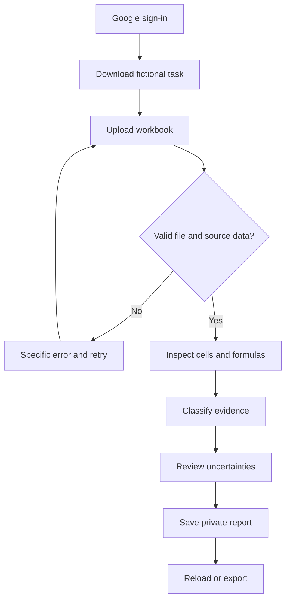
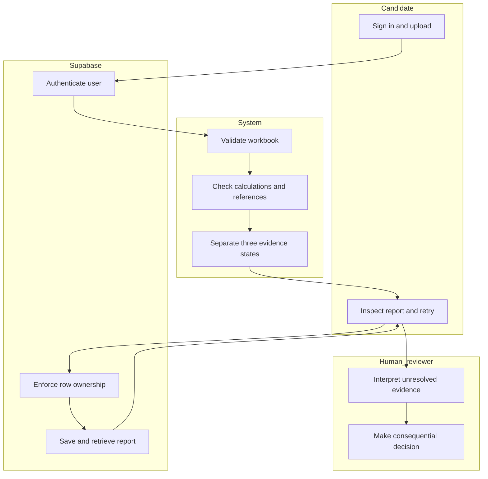

# SkillProof MX — Week 12 Core Build Packet

Prepared before Week 12 implementation. Founder: Valeria Karam Galland. Source: team blueprint supplied in this conversation. Charter: CHARTER.md. This packet supersedes the Week 4 packet, retained under week12/.

## Problem in my words
A CV does not show how a junior candidate solves an Excel task. A number or AI opinion alone also fails to show that evidence. I want every consequential finding to point to the work that supports it and identify what still needs human review.

## Exact user
A Spanish-speaking recent graduate in Mexico applying for a junior financial analyst role, familiar with basic Excel but uncertain about automated hiring. The secondary actor is the human reviewer; the product does not assume a paid review service exists.

## Definition of success
Before the module closes, a user can open the real venture domain, sign in with Google, download the fictional workbook, upload completed evidence, inspect verified/contradictory/pending findings linked to cells and formulas, save the report privately, reload it and export it. Retry replaces the current displayed attempt without defining the person's identity. Success requires the live domain and end-to-end storage tests, not just a local build.

## Image-generated mockup

Design intent: navy/teal evidence table; no permanent identity score; three evidence states; visible fictional-data label; export and retry. This is a design concept, not evidence of deployment. The original Week 4 generated concept remains in assets/skillproof-mx-results-mockup.png.

## Core flow

## Actor swimlane

## Benchmark line
Best-existing-solution candidate: TestGorilla's Financial Modeling in Excel assessment, previously selected in the Week 4 packet: https://www.testgorilla.com/test-library/role-specific-skills-tests/financial-modeling-in-excel-test/ . This is a comparative design benchmark, not a verified claim of global superiority; current source retrieval failed in this session and must be checked before submission.
Mine localizes through Spanish instructions, MXN fictional financial data, inspectable cell evidence, visible uncertainties and retries, with human hiring judgment.

## Long view
If this slice works, SkillProof MX becomes a trusted library of narrow, verifiable entry-level tasks in Mexico. Employers could add validated criteria while candidates retain control over their latest evidence. Growth depends on demonstrated assessment validity, user demand and a sustainable human-review process.

## Scope cut
No marketplace, resume ranking, payments, automatic hiring, surveillance, claim of authorship verification, real candidate demo records, or guaranteed appeals service. Unsupported Excel formulas remain pending; formula presence alone is not proof. AI explanation output, if enabled or simulated, cannot establish verified numerical findings.

## Architecture and stack
| Layer | Required technology | Responsibility |
|---|---|---|
| Interface | Next.js / React + Tailwind | Accessible upload and evidence report |
| Server | Next.js route + Zod | Size/type validation and deterministic checks |
| Workbook reader | fflate + fast-xml-parser | Read OOXML without executing macros or arbitrary code |
| Identity | Supabase Auth / Google | Identify owner before persistence |
| Persistence | Supabase Postgres + RLS | Owner-scoped reports, no source workbook retention |
| Source | GitHub | Reviewable commits and packet history |
| Hosting | Vercel free tier | Two real deployments and venture domain |

Current inherited code has Next.js/React and a deterministic parser; Tailwind, Supabase integration and real-domain configuration must be completed and verified. No service setup is claimed by this packet.

## Security floor and data handling
Secrets only in Vercel environment variables; never in source, reports or transcript. Google sign-in before persisting personal information. RLS on reports with auth.uid() = user_id for all operations. Validate file extension, bytes, uncompressed content, expected worksheet, source values and explanation length. Fictional seeds only, visibly labeled. Workbook bytes stay in memory and are discarded. Reports stored privately; logout clears displayed sensitive data. Test user A versus user B reads and updates before live use.

## Test plan
1. Correct supported formulas, cached values missing: independently calculate supported expressions and verify evidence.
2. Correct number hardcoded: accuracy may pass but formula evidence remains pending.
3. Formula =1+1 with correct cached value: contradictory; never grant traceability for mere presence.
4. Unsupported functions or external references: pending, no arbitrary execution.
5. Altered source numbers: refuse the template rather than comparing against an unrelated fixed key.
6. Missing cells, invalid extension, empty/corrupt/oversize archive: clear errors.
7. Review button must not imply a real request or response SLA without a service.
8. Export current report as JSON; confirm evidence and warnings persist.
9. Supabase A/B ownership, signed-out access denied, saved report survives reload.
10. Domain resolves, HTTPS works, Google OAuth redirect succeeds at the real domain.

## Measurement
Compare manual review, a simple rules checker and the core on the same fictional tasks. Include preparation, processing, inspection, correction and rework in elapsed effort. Record missed errors and false positives. 10:1 remains unproven until effort and quality both support it.

## Mechanical and persona passes
Log a reproduced pre-fix failure, correction, retest and actual deployment IDs. Persona: Sofia, 23, recent Mexican graduate, basic Excel, fears permanent automated rejection. In a fresh chat show real screenshots in order, collect hesitation and abandonment points, fix the worst and retest. A plan or heuristic review is not a completed persona session.

## Commit and deploy plan
1 docs: charter and packet before core changes.
2 test: reproduce misleading formula evidence.
3 fix: independently inspect supported formulas and references.
4 feat: show evidence states and export, remove unsupported service promises.
5 docs: security setup, test results and session close.
Deploy 1 after authenticated save works; deploy 2 after a documented bug fix and retest. Commit count is a real history requirement; local commits are not GitHub pushes.

## Submission status
Live domain, GitHub URL, Vercel deployment IDs, Supabase ownership tests, fresh-chat persona, demo recording and complete transcript remain to be verified. No fabricated links, timestamps, users or deployment evidence.
